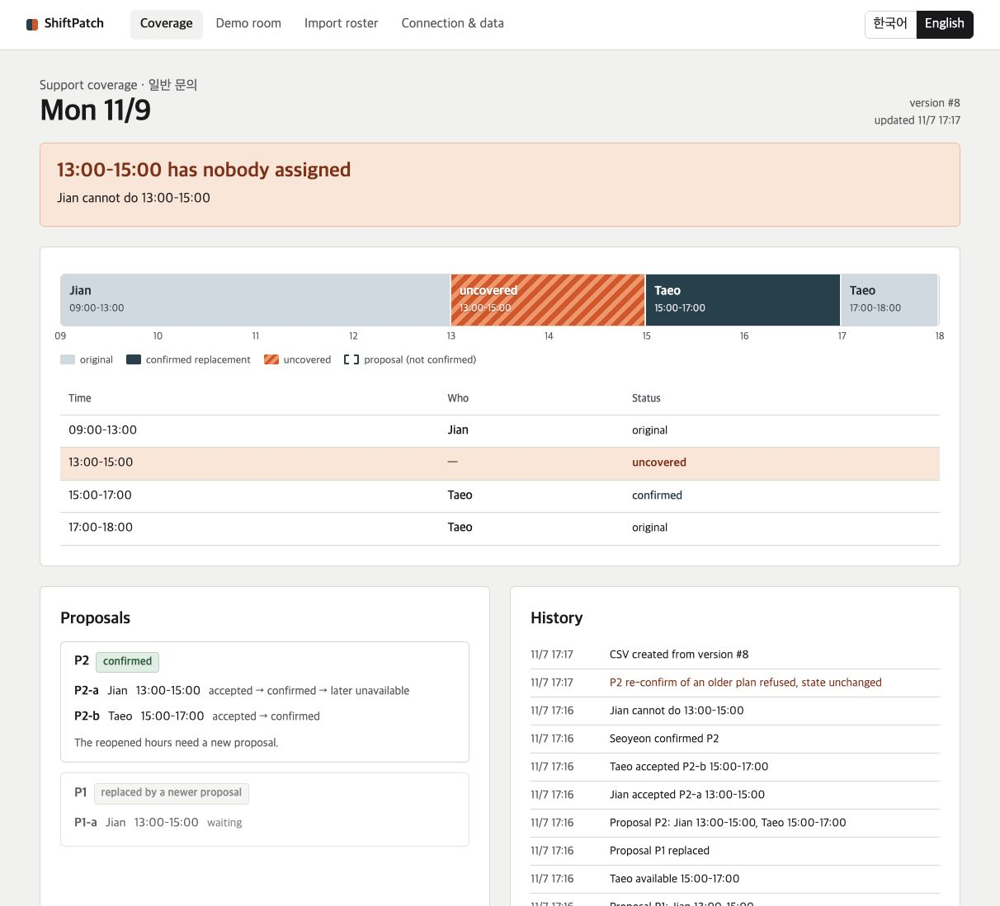

# ShiftPatch

**Fill a sudden gap in a support shift from the team chat room.**

Minsu can't cover Monday's 13:00–17:00 support shift. Colleagues reply in the room with the hours they can take. ShiftPatch turns those replies into a replacement proposal; each person accepts only their own part, and the manager confirms. If someone drops out later, only their hours reopen — everyone else's confirmed work stays. The team gets a coverage board and a CSV snapshot showing who covers each interval and where a gap remains.

People, shifts and messages are fictional: Seoyeon (manager), Minsu (13–17), Jian (09–13), Taeo (17–18), Monday 2026-11-09, Asia/Seoul, ordinary customer support. The Switch transport in the live run was real: a local self-hosted Switch 0.31 server delivered the messages from four synthetic Mattermost accounts. No real staff have used it.



## What it does

| Step | In the room | What the program checks |
|---|---|---|
| Hedged message | `@ShiftPatch 내일 13~17시 못 할 것 같아요` | Not applied. The agent shows the exact action and asks `네/아니요` (Q1, 10 min). |
| Availability | `가능 13-15`, or free text read by AI then confirmed | Recorded as *available*, never as accepting. |
| Proposal | posted automatically | candidate = availability ∩ gap − own shifts; never widened |
| Self acceptance | `수락 P2-a` | only the person the part belongs to; proxies refused |
| Revoke before confirm | `수락 취소 P2-a` | that acceptance only |
| Manager confirm | `확정 P2` | one transaction: manager role, every acceptance, unchanged facts, still inside the gap, no overlap |
| Inability after confirm | `불가 2026-11-09 13:00-15:00` | only that interval reopens; history kept; old plan can't be re-confirmed |
| Board / export | `표`, `내보내기` | CSV/ICS from one frozen snapshot version |

English works too (`available 13-15`, `accept P2-a`, `confirm P2`, `unavailable …`, `status`, `export`).

## Verification status

| Area | Status (2026-11-07 KST) | Evidence |
|---|---|---|
| Live Switch, local self-hosted v0.31.0, Mattermost | **Verified on a synthetic team.** Four accounts ran the seven steps above: inability, two availabilities, two self-acceptances, the manager's confirmation, then a partial inability. Only 13–15 reopened. This was run independently by the root operator, not by the build agent. | [qa/LIVE_SWITCH_REPORT.md](qa/LIVE_SWITCH_REPORT.md) |
| Domain rules, pipeline, roster/OCR (real Apple Vision), export, HTTP API | 89 automated tests pass | [qa/TEST_REPORT.md](qa/TEST_REPORT.md) |
| Switch reconnect, `gap`, eviction, bad key, handler failure halt | contract double only, not live | [tests/test_switch_contract.py](tests/test_switch_contract.py) |
| Browser flow in the local demo room | 10/10 E2E steps, run before the latest history-wording fix | [qa/TEST_REPORT.md](qa/TEST_REPORT.md) |
| `manage.py register-agent`, `set-addressing` | never run against a server; manual instructions only | — |
| Managed/cloud Switch, Slack/Teams/Discord/Telegram | not tested | — |
| Demo video | 77-second captioned local screencast prepared; no public URL yet | prepared separately from the source |
| Real staff, public deployment, public repo | not done | — |

## Install and run (macOS)

Requirements: Python 3.11+ (tested with 3.14.5; standard library only), macOS with Xcode command-line tools for the OCR helper (`swift`). Optional: the Claude Code CLI already logged in (for AI reading of free text), Node 18+ and Google Chrome (for browser tests).

```bash
cd app
python3 run.py --port 8765            # http://127.0.0.1:8765/  (binds 127.0.0.1 only)
```

First run shows a landing page. Start with **합성 예시 CSV로 시작** (synthetic CSV) or upload a roster image (`fixtures/ocr/clear.png`). Review the table, confirm each name→account link, tick the approval box, import. Then open **시연 방** (demo room) and follow the numbered script on the right; it fills the input, you press send.

Switch the UI language with the 한국어 / English toggle. Data lives in `app/data/` (SQLite + `exports/`). `SHIFTPATCH_AI=off` disables AI reading.

The final corrected source was independently checked again through the local Switch stack and the native Mattermost browser UI. See [final live evidence](qa/final-live-evidence.json). For this local stack, open Mattermost at `http://localhost:18065` (its configured SiteURL); using `127.0.0.1` for that chat page fails its WebSocket origin check. The ShiftPatch board itself uses `127.0.0.1:8766`.

## Tests

```bash
cd app
python3 -m unittest discover -s tests          # 89 tests: domain, pipeline, roster/OCR (real Vision), export, HTTP, Switch contract double
npm install && node e2e/run.mjs                # browser E2E with system Chrome via Playwright (AI off, deterministic)
node e2e/ai_trace.mjs                          # browser run of the free-text path with the real AI reader
python3 qa/ai_live_check.py                    # 7 synthetic sentences through the live CLI reader
```

Latest results with commands, durations and exit codes: [qa/TEST_REPORT.md](qa/TEST_REPORT.md).

## Architecture

```
trusted transport event (Switch WebSocket frame | local demo room)
  → TrustedEnvelope {room, message_id, sender, created_ms}     ← actor comes only from here
  → idempotency (processed by message id; edited body → not applied)
  → identity link → freshness window → execution context (room/message/actor, 120 s, one live per room)
  → exact grammar  |  AI suggestion (CLI, no tools, JSON schema)  |  rule reader for hedged + explicit range
  → BEGIN IMMEDIATE: verify context → per-actor watermark → domain write (savepoint)
                     → history + processed + reply outbox  → COMMIT (or roll back everything)
  → outbox dispatcher (retries replies only)     → snapshot exporter (CSV/ICS, temp+fsync+rename)
```

| Module | Role |
|---|---|
| `shiftpatch/engine.py` | intervals, coverage, proposals, carry-forward, accept/revoke, confirm, inability, pending confirmations, watermark |
| `shiftpatch/agent.py` | the pipeline above; replies (KO/EN) |
| `shiftpatch/grammar.py` | full-match command grammar; tentative/quoted/forwarded/ambiguous-hour detection |
| `shiftpatch/interpret.py` | optional Claude CLI reader (suggest-only) |
| `shiftpatch/switch_bridge.py`, `wsclient.py` | Switch agent protocol over WebSocket (stdlib RFC 6455 client) |
| `shiftpatch/local_demo.py` | synthetic local room with an actor picker (local kind only) |
| `shiftpatch/roster.py`, `ocr.py`, `ocr/roster_ocr.swift` | CSV/OCR drafts, validation, manager-approved one-time import |
| `shiftpatch/exporter.py` | snapshot CSV / confirmed-only ICS |
| `shiftpatch/server.py`, `web/` | local web UI and JSON API |

Key rules: half-open intervals on 30-minute boundaries, one day, no overnight. An acceptance attaches to a part's immutable component hash (room, date, duty, person, interval, availability id+revision, account-link revision, roster version), so accepting never invalidates the proposal. A newer proposal reuses an acceptance only when that hash is identical (shown as "carried from P1-a"); anything wider or changed needs a fresh acceptance. Revoking withdraws every live acceptance of that component so it can't be carried later. A `네/yes` binds to one open confirmation of the same person, room, exact action and dependency revision, expiring after 10 minutes; with two open, a number is required (`네 Q3`). An availability confirmation can never become a shift acceptance. Messages older or equal to the person's last applied message are not applied (ask to resend); timestamps more than 2 min in the future or 15 min in the past are refused. Confirm and inability from different people are serialized by commit order: either order ends with the inability reflected.

## Switch

ShiftPatch sits in a Switch room as a custom agent. The adapter follows [the official agent protocol](https://docs.switchagents.ai/), checked on 2026-11-07. It uses WebSocket; the older SSE transport is deprecated:

- open `GET /agents/{id}/connection/ws?connection_id=<persisted uuid>&rooms=<room>&filter=addressed&start_from=<cursor|head>&expected_generation=<g>` with `Authorization: Bearer <agent API key>`
- read `connection_state` (rooms, cursor, generation); answer every `ping` immediately with `{"type":"pong","cursor":n}` where *n* is the highest sequence **processed** (cursor advances only after the domain commit)
- domain frames `{"event":"message","data":{room_id,payload:{addressed,sender,sender_name,message_id,body,timestamp}},"id":seq}`; act only when `payload.addressed` is true, the room matches, and `sender` is linked to a staff member
- `gap` → take `resumed_at`, note it on the next reply; `evicted taken_over` and close codes 4400/4401/4403/4409 stop; `heartbeat_lapsed`/1011/1012/drops reconnect with backoff
- replies: `POST /agents/{id}/message {room_id, content}`; registration: `POST /agents` with a registration key; addressing: `update_agent_detail`

Safeguards: unlinked senders (including other agents) change nothing; `com.switch.auto_reply`/`com.switch.admin` markers and our own name are ignored; quoted (`>`) and forwarded text never executes; a redelivered message id is a no-op and an edited body is not applied. The web UI has **no** path to post into a Switch room as someone. If handling one message keeps failing (5 attempts), the bridge stops with state `halted` and keeps the cursor before that message. It does not consume anything later, so restarting ShiftPatch replays the failed message.

### Connect to a local Switch

The live run in [qa/LIVE_SWITCH_REPORT.md](qa/LIVE_SWITCH_REPORT.md) used a self-hosted Switch v0.31.0 with Mattermost on the same Mac. Root registered the agent outside ShiftPatch, then wrote the links and roster with the same functions behind `import-links` and `import-roster`. The CLI below is the intended manual path. Steps marked *untested* have never run against a server.

1. Start the local Switch server (see the Switch self-host docs) and create a room with the four people.
2. Create a registration key in the Gateway (API Keys), then:
   ```bash
   export SHIFTPATCH_REGISTRATION_KEY=…            # not stored by ShiftPatch
   python3 manage.py register-agent --base-url http://localhost:8000 --name shiftpatch   # untested
   python3 manage.py set-addressing anyone                                               # untested
   python3 manage.py set-room '<room id>'
   python3 manage.py import-links config/links.json      # opaque payload.sender ids → staff ids (see config/links.example.json)
   python3 manage.py import-roster fixtures/roster_sample.csv config/mapping.example.json --approve
   python3 run.py                                         # bridge starts when config/switch.local.json is complete
   ```
   Participant ids are opaque. One way to learn them, the way root did: have each person send one `@shiftpatch` message and read `payload.sender` from the delivered frame.
3. Talk to `@shiftpatch` in the room. Write dates as ISO (`불가 2026-11-09 13:00-17:00`): a Switch room runs on the real clock, so `내일` means tomorrow from the actual date. The `표`/`status` reply links to `http://127.0.0.1:<port>/?room=<url-encoded room id>#/board`, which opens that room's board on the host Mac.

## AI use

- **In the product:** optional. Free-form messages that aren't exact commands may be read by the locally logged-in Claude Code CLI (`claude -p --json-schema … --tools "" --no-session-persistence`, model alias `sonnet`, 45 s timeout, at most 2 at once, isolated empty working directory, prompt via stdin, no shell). The model only returns one suggested action for the sender; the server validates it and asks the sender to confirm. Replies say "AI가 읽은 내용 / read by AI" or "규칙으로 읽은 내용 / read by rule". When the CLI is unavailable the app says so and exact commands keep working. With AI reading on, that sentence goes to the model provider under the CLI login's terms.
- **In development:** this code, tests and docs were written by an AI coding agent (Claude) directed by the entrant; planning drafts were produced in earlier AI-assisted sessions. The entrant is responsible for reviewing and understanding the submission.

## Data handling

Message bodies are not written to the app's disk: the DB keeps structured actions, message ids and a body hash (for edit detection). The local demo transcript lives in memory only. No reason is asked for. Logs carry method and path only. Exports neutralise formula-like cells. The board binds to 127.0.0.1, checks the `Host` header, and every write needs a per-process token and same-origin; there is no remote access or membership check yet.

## OCR provenance

`ocr/roster_ocr.swift` is adapted from the earlier isolated experiment (`../experiments/roster-ocr/`) and uses Apple Vision `VNRecognizeTextRequest` locally. Fixtures `clear/small/ambiguous.png` are copied from that experiment; `unknown_collision.png` and `unsupported.png` are generated by `ocr/make_fixtures.swift`. Scope: one date, one duty, five fixed columns. Photos with perspective, handwriting and merged cells are not verified. OCR never sets roles or acceptance; the manager must review, confirm each account link and approve, and import is refused once coordination has started.

## Screenshots (real captures from `node e2e/run.mjs` / `e2e/ai_trace.mjs`)

`docs/screenshots/`: `01-landing-ko.png`, `01b-landing-en.png`, `02-ocr-review-ambiguous.png`, `03-ocr-review-clear.png`, `04-board-initial.png`, `05-room-after-confirm.png`, `06-board-confirmed.png`, `07-room-after-drop.png`, `08-board-gap-reopened.png`, `08b-board-gap-reopened-en.png`, `09-board-mobile.png`, `10-connect-blocked.png` (an instance without Switch config, captured before the live run), `11-room-ai-path.png`. The screenshots come from the local demo room, not the Switch room.

## License and provenance

MIT (see `LICENSE`; the entrant should confirm before publishing). Python standard library only at runtime; Playwright (Apache-2.0) is a dev dependency for browser tests. Switch protocol details come from docs.switchagents.ai (copies in [the official protocol](https://docs.switchagents.ai/) for reference). No third-party code is vendored.
