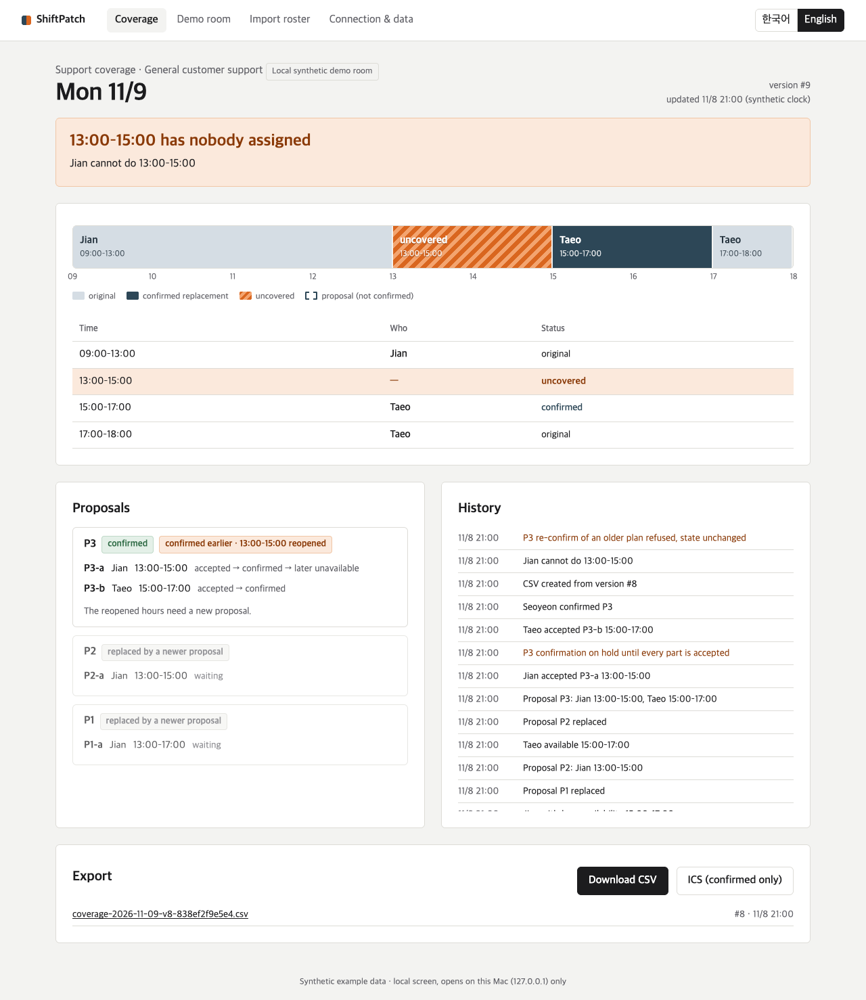

# ShiftPatch

**Fill a sudden gap in a support shift from the team chat room.**

Minsu can't cover Monday 13:00–17:00. In the team's chat room, Jian offers 13:00–15:00 and Taeo offers 15:00–17:00. ShiftPatch turns those replies into a proposal with one part per person. Each person accepts their own part, and the manager confirms. If Jian later drops out, only 13:00–15:00 reopens; Taeo's confirmed hours stay. A board and a CSV snapshot show who covers each interval and where the gap is.

This is a prototype with one fixed team and one day built in: Seoyeon (manager), Jian (09–13), Minsu (13–17), Taeo (17–18), Monday 2026-11-09, Asia/Seoul, general customer support. The people and messages are fictional. The Switch connection is real: a local self-hosted Switch 0.31.0 server delivered the messages from four synthetic Mattermost accounts, all operated by one developer. No real staff have used it.



## Run it (macOS)

Requirements: Python 3.11+ (tested with 3.14.5; standard library only). For roster images: macOS with Xcode command-line tools (`swift`). Optional: a signed-in Claude Code CLI for reading free-form messages; Node 18+ and Google Chrome for the browser tests.

From the folder that contains `run.py` (the repository root, or the unpacked source ZIP):

```bash
python3 run.py --port 8765            # open http://127.0.0.1:8765/ (binds 127.0.0.1 only)
```

The first screen offers **Start with the synthetic CSV** or an image upload (`fixtures/ocr/clear.png`). Review the table, confirm each name → account link, tick the approval box and import. Then open **Demo room** and follow the numbered script on the right; a line fills the input and you press Send. Send stays disabled until the reply is back.

The script matches the AI setting. With AI reading on, line 3 is "I can do two hours after lunch" and the AI's question is answered on line 4. With it off (no signed-in Claude CLI, or `SHIFTPATCH_AI=off`), line 3 is the exact command `available 2026-11-09 13:00-15:00`, and lines 4 and 8 are marked skipped. Either way the script ends with the split confirmation and only Jian's 13:00–15:00 reopened.

The demo room is a rehearsal on one Mac: one person plays four synthetic accounts on a synthetic clock set to Sunday evening, 11/8. In use, people write in the Switch room and this page is the board.

Data goes to `./data/` (SQLite and `exports/`), or to `--data <dir>`. `SHIFTPATCH_AI=off` turns off the AI reader. The UI has a 한국어 / English toggle.

Ctrl-C or `kill <pid>` stops it: the Switch connection is closed first, a reply that is being sent gets up to 15 s to finish, and the last line printed is `ShiftPatch stopped`.

## Connect it to a local Switch

This is the path used for the live checks on 2026-11-07 (agent `shiftpatch3`, five new private rooms, final code `3e6c861`; [report](qa/LIVE_SWITCH_REPORT.md)). No key or password is in this repository.

1. Run a self-hosted Switch with its Mattermost bridge (Switch self-host docs; the check used tag `switch-v0.31.0`, every host port bound to 127.0.0.1). Create four Mattermost users for the synthetic team.
2. Register the agent with a registration key from the Gateway (**API Keys**). The key is read from the environment and not stored:
   ```bash
   export SHIFTPATCH_REGISTRATION_KEY=…
   python3 manage.py register-agent --base-url http://127.0.0.1:18000 --name shiftpatch3
   ```
   This writes `config/switch.local.json` (mode 0600, git-ignored). `--config <file>` before the command keeps it somewhere else; pass the same file to `run.py --switch-config`.
3. In the Gateway, create a private room with the agent and the four users, and give the agent an addressing rule for that room (users `*`). `python3 manage.py set-addressing anyone` exists, but on Switch 0.31.0 the server answered HTTP 403 to it; the Gateway rule is what worked.
4. `python3 manage.py set-room '<room id>'`
5. Start ShiftPatch: `python3 run.py --port 8765`.
6. Link each Switch participant to a staff ID. Participant IDs are opaque, so take them from real messages:
   - each person sends one message to the agent in the room, e.g. `@shiftpatch3 status`. ShiftPatch answers that the account is not linked and changes nothing;
   - list what arrived. The connection page (`#/connect`) shows the same list:
     ```bash
     python3 manage.py senders
     ```
     It prints each sender ID exactly as Switch delivered it, with the display name and time. IDs stay listed for one hour, and the message text is not stored;
   - link each one:
     ```bash
     python3 manage.py link '<sender id from senders>' jian
     ```
   `link` refuses an ID that has not written to the agent in this room. Do not build an ID from another person's ID or a display name. `import-links <file>` takes the same IDs from a file (`config/links.example.json`).
7. Import the day's roster for that room in the browser, from a CSV or a roster image: `http://127.0.0.1:8765/?room=<url-encoded room id>#/import`. The review screen lists the participant ID that will act as each person in this room. A person without a linked account blocks the import. `python3 manage.py import-roster fixtures/roster_sample.csv config/mapping.example.json --approve` does the same from the command line.
8. In the room, write `@shiftpatch3 …`. Use dates like `unavailable 2026-11-09 13:00-15:00`: a Switch room runs on the real clock, so "tomorrow" means the day after today. `status` replies with a link to this room's board on the host Mac.

Open Mattermost at its configured SiteURL (`http://localhost:18065` in the check). The `127.0.0.1` form failed Mattermost's WebSocket origin check.

## What happens in the room

| Step | Example | What the program checks |
|---|---|---|
| Hedged message | `I might be unable to cover Monday 13-17` | Nothing is recorded. The agent states the exact action and asks `yes`/`no` (Q1, open for 10 minutes from when ShiftPatch received the message). |
| Late reply | a `yes` written before Minsu's newer message but delivered after it | It does not approve or close the question about that newer message, bare or with its Q id; the reply says so and nothing changes. |
| Availability | `available 2026-11-09 13:00-15:00`, or free text read by AI and then confirmed | Recorded as *available*, never as accepting. Clock times are checked: `13:60` or `24:30` is refused and nothing changes. `24:00` is the end of the day. |
| Proposal | listed in the same reply | Hours offered inside the gap, minus the person's own shifts. The reply names each part, e.g. `Jian: accept P2-a · Taeo: accept P2-b. Then Seoyeon sends confirm P2.` |
| Self acceptance | `accept P2-a` | Only the person the part belongs to |
| Withdraw | `withdraw 14:00-15:00` or `withdraw` | A range removes exactly those hours; the rest of that availability stays. Bare `withdraw` removes all of it. |
| Manager confirm | `confirm P2` | One transaction: manager role, every acceptance, unchanged facts, still inside the gap, no overlap |
| Inability after confirm | `unavailable 2026-11-09 13:00-15:00` | Only that interval reopens. History keeps P2 as confirmed; the board adds "confirmed earlier · 13:00–15:00 reopened". Sending `confirm P2` again is refused and the reply says why. |
| Board / export | `status`, `export`, `export ics` | CSV/ICS from one snapshot version; the chat reply names the same file the board lists. ICS writes an end of 24:00 as 00:00 of the next day. |

Korean works too (`가능 13-15`, `수락 P2-a`, `확정 P2`, `불가 …`, `표`, `내보내기`).

## Verification status (2026-11-07 KST)

The code that was tested is commit `3e6c861`. The commits after it change documentation and test output only. Earlier runs used `a70ae7e` and `9325ac3`; `3e6c861` adds only the handling of confirmation questions created before the upgrade (below), and `9325ac3` only a history label and a table style.

| Area | Status | Evidence |
|---|---|---|
| Live local Switch 0.31.0 + Mattermost, AI reader on | Run E, 2026-11-07 21:48–21:50 KST, code `3e6c861`, new private room, same agent `shiftpatch3`, the locally signed-in Claude CLI. Minsu's hedged line and Jian's "I can cover two hours after lunch on Monday" came back as questions marked read by AI (`interpreted_by: ai` in the stored records), each confirmed by that person's `yes`; the manager's "both of them said yes" was read by AI and changed nothing; then both acceptances, confirm, Jian's 13–15 dropout, refused re-confirm, CSV and ICS export, status. Version 8, only 13–15 uncovered, 20 replies sent, exit 0 on SIGTERM. | [qa/LIVE_SWITCH_REPORT.md](qa/LIVE_SWITCH_REPORT.md) |
| Live local Switch 0.31.0 + Mattermost, AI off | Four runs on 2026-11-07, each in a new private room with the new agent `shiftpatch3`, a new data folder and AI reading off: A (21:01–21:05) and B (21:06–21:09) at `a70ae7e`; C (21:15–21:17) and D (21:21–21:23, recorded for the video) at `9325ac3`. Each run: four identity probes → `manage.py senders` → `manage.py link` (room version stayed 0) → roster image read on the review screen → hedged message → bare `yes` → `13:60` refused → two availabilities → two self-acceptances → confirm → Jian drops 13–15 → old confirm refused → CSV and ICS export → status. All four ended at version 8 with only 13–15 uncovered; every reply was sent; each server exited 0 on SIGTERM. Synthetic team, one operator posting through Mattermost's API. | [qa/LIVE_SWITCH_REPORT.md](qa/LIVE_SWITCH_REPORT.md), [qa/live-runs.json](qa/live-runs.json) |
| Earlier full live run with the AI reader | Once, at `c65b2ec`, before the socket cleanup and these fixes. | same |
| `manage.py register-agent`, `set-room`, `senders`, `link` | Ran against that server | same |
| `manage.py set-addressing` | Server answered HTTP 403 (four more times on 2026-11-07); Gateway rule used instead | same |
| Unit and integration tests | 167 pass with no ResourceWarning, also with warnings made errors: the earlier 136 and 31 for the final review (late yes/no, questions from before the upgrade including a real migration, demo queue over real local HTTP, sender IDs and linking, 24:00). Of the first 27, 22 fail against `3ca97d6`; the 5 that pass there check behaviour that was already right. 3 of the 4 upgrade tests fail against `9325ac3`. | [qa/TEST_REPORT.md](qa/TEST_REPORT.md) |
| Browser flow | 15/15 E2E steps, AI off, including the room's own script clicked line by line to the reopened 13–15, once in Korean and once in English. The server then exits 0 on SIGTERM with nothing on stderr but its request log. | [qa/e2e-result.json](qa/e2e-result.json) |
| AI reader | `node e2e/ai_trace.mjs`: the AI script lines 1–4 and 8 through the real Claude CLI reader, 6/6 checks | [qa/e2e-ai-result.json](qa/e2e-ai-result.json) |
| Late yes/no, out-of-order questions | Synthetic envelopes with chosen timestamps. How Switch's sequence relates to the platform's message time was not measured on a live server. | `tests/test_final_six.py` |
| Reconnect, malformed frames, silent socket, gap, eviction, handler-failure halt | Contract double and fake sockets only, not triggered on a live server | `tests/test_switch_contract.py`, `tests/test_critique_regressions.py` |
| ICS in a calendar app | Not tested. The file content was checked (next-day 00:00 for a 24:00 end). | `tests/test_final_six.py` |
| Managed/cloud Switch; Slack, Teams, Discord, Telegram | Not tested | — |
| Real staff, public deployment, public repository | Not done | — |

## Tests

```bash
python3 -m unittest discover -s tests          # 167 tests
npm install && node e2e/run.mjs                # browser E2E, system Chrome via Playwright, AI off
node e2e/ai_trace.mjs                          # free-text path with the real AI reader
python3 qa/ai_live_check.py                    # 7 synthetic sentences through the CLI reader
```

To reuse a Playwright install that already exists elsewhere, put its `node_modules` path in `e2e/playwright-dir.local`.

## Architecture

```
trusted transport event (Switch WebSocket frame | local demo room)
  → TrustedEnvelope {room, message_id, sender, created_ms, received_ms}   ← actor comes only from here
  → idempotency (processed by message id; edited body → not applied)
  → identity link → freshness window → execution context (room/message/actor, one live per room)
  → exact grammar  |  AI suggestion (CLI, no tools, JSON schema)  |  rule reader for hedged + explicit range
  → BEGIN IMMEDIATE: verify context → per-actor watermark → domain write (savepoint)
                     → history + processed + reply outbox  → COMMIT (or roll back everything)
  → outbox dispatcher (replies only, in order per room)   → snapshot exporter (CSV/ICS, temp+fsync+rename)
```

| Module | Role |
|---|---|
| `shiftpatch/engine.py` | intervals, coverage, proposals, carry-forward, accept/revoke, confirm, inability, withdrawals, confirmation questions, watermark |
| `shiftpatch/agent.py` | the pipeline above; replies (KO/EN); export side effect |
| `shiftpatch/grammar.py` | full-match command grammar; tentative/quoted/forwarded/ambiguous-hour detection; strict clock times |
| `shiftpatch/interpret.py` | optional Claude CLI reader (suggest-only) |
| `shiftpatch/switch_bridge.py`, `wsclient.py` | Switch agent protocol over WebSocket (stdlib RFC 6455 client) |
| `shiftpatch/outbox.py` | reply delivery: lease claim, per-room order, backoff, failed-reply view |
| `shiftpatch/local_demo.py` | synthetic local room with an actor picker (local kind only); one message per room at a time, in arrival order |
| `shiftpatch/roster.py`, `ocr.py`, `ocr/roster_ocr.swift` | CSV/OCR drafts, validation, room accounts, manager-approved one-time import, account links |
| `shiftpatch/exporter.py` | snapshot CSV / confirmed-only ICS |
| `shiftpatch/server.py`, `web/` | local web UI and JSON API |

Rules worth knowing:

- Half-open intervals on 30-minute boundaries, one day, no overnight.
- An acceptance attaches to a part's component hash: room, date, duty, person, interval, availability id and revision, account-link revision, roster version. A newer proposal reuses an acceptance only when that hash is identical (shown as "carried from P1-a").
- A `yes` or `no` answers one open question of the same person, asked to the same chat account, for the exact action and dependency revision. The question stays open 10 minutes from when ShiftPatch received the message. A reply written (platform timestamp) before the message a question is about never answers that question. With two open, a number is required (`yes Q3`).
- A message processed late does not replace a newer open question of the same kind.
- A question created before this upgrade has no record of when its message was written. Opening the data folder closes such open questions (nothing they asked about was applied, and `run.py` says how many), and no `yes`/`no` can answer one. Confirmed coverage and history are not touched; send the message again if it still applies.
- Which message came first is decided by the platform timestamp: a message older than or equal to the person's last applied one is not applied. Messages more than 2 minutes in the future or 15 minutes in the past are refused.
- Account links can change only before coordination starts. A relink closes that person's open questions and raises the link revision above every earlier one.

## Switch protocol

The adapter follows [the official agent protocol](https://docs.switchagents.ai/), checked on 2026-11-07, over WebSocket (SSE is deprecated):

- open `GET /agents/{id}/connection/ws?connection_id=<persisted uuid>&rooms=<room>&filter=addressed&start_from=<cursor|head>&expected_generation=<g>` with `Authorization: Bearer <agent API key>`
- read `connection_state` (rooms, cursor, generation); answer every `ping` with `{"type":"pong","cursor":n}`, where *n* is the highest sequence **processed** (the cursor moves only after the domain commit)
- domain frames `{"event":"message","data":{room_id,payload:{addressed,sender,sender_name,message_id,body,timestamp}},"id":seq}`; act only when `payload.addressed` is true, the room matches and `sender` is linked to a staff member
- a frame that is not JSON, or carries a non-integer sequence or cursor, drops the connection; it reopens from the processed cursor. Hearing nothing for 15 s (Switch pings every 2 s) also reconnects
- `gap` → take `resumed_at`, note it on the next reply; `evicted taken_over` and close codes 4400/4401/4403/4409 stop; `heartbeat_lapsed`/1011/1012/drops reconnect with backoff
- replies: `POST /agents/{id}/message {room_id, content}`

Safeguards: unlinked senders (including other agents) change nothing; `com.switch.auto_reply`/`com.switch.admin` markers and the agent's own name are ignored; quoted (`>`) and forwarded text never executes; a redelivered message id is a no-op and an edited body is not applied. The web UI has **no** path to post into a Switch room as someone. If handling one message keeps failing (5 attempts), the bridge stops with state `halted` and keeps the cursor before that message; restarting ShiftPatch replays it.

Replies go out in commit order per room. A failed send is retried after 1, 2, 4, 8 and 16 s; after six failures the reply is shown on the board under "Replies that did not reach the chat room" with a **Send replies again** button, and later replies continue. Sending again moves only the reply; the record already changed. Delivery is at least once: if ShiftPatch stops after Switch accepted a reply but before marking it sent, that reply is posted again after restart.

## AI use

- **In the product:** optional. Messages that aren't exact commands may be read by the locally signed-in Claude Code CLI (`claude -p --json-schema … --tools "" --no-session-persistence`, model alias `sonnet`, 45 s timeout, at most 2 at once, empty working directory, prompt via stdin). The model returns one suggested action for the sender. The server checks it and asks the sender to confirm; nothing changes before `yes`. Replies say "read by AI" or "read by rule". Exact commands such as `accept P2-a` never go to the model. With AI reading on, that sentence goes to the model provider under the CLI login's terms.
- **In development:** the code, tests and documentation were written with AI coding tools (Claude and Codex) directed by the entrant, who is responsible for reviewing the submission.

## Data handling

Message bodies are not written to the app's disk: the database keeps structured actions, message ids, a body hash (for edit detection) and ShiftPatch's own replies. For a Switch account that writes before it is linked, it keeps the sender ID, display name, times and a count for one hour, so the manager can link it. The local demo transcript lives in memory only. No reason is asked for. Logs carry method and path only. Exports neutralise formula-like cells. The board binds to 127.0.0.1, checks the `Host` header, and every write needs a per-process token and same origin; there is no remote access or membership check.

## OCR provenance

`ocr/roster_ocr.swift` is adapted from an earlier isolated experiment and uses Apple Vision `VNRecognizeTextRequest` locally. Fixtures `clear/small/ambiguous.png` come from that experiment; `unknown_collision.png` and `unsupported.png` are generated by `ocr/make_fixtures.swift`. Scope: one date, one duty, five fixed columns. Photos with perspective, handwriting and merged cells are not verified. OCR never sets roles, accounts or acceptance; the manager reviews, confirms each name link and approves, and import is refused once coordination has started.

## Screenshots

`docs/screenshots/` holds captures from `node e2e/run.mjs` (local demo room, plus a synthetic Switch-room record with no server behind it for the review screen): landing, OCR review, board, room, reopened board (KO/EN), mobile, connection page, `12-board-delivery-failed.png`, `13-switch-review-unlinked.png`, `14-room-script-ai-off-ko.png` (the AI-off script after line 13). `11-room-ai-path.png` is from `node e2e/ai_trace.mjs`. `live-switch-board-en.jpg` is from the earlier live run on the pre-fix source.

## Demo video

A 122-second silent video with English captions, cut from the recorded live run of `9325ac3` (local Switch 0.31.0 + Mattermost, AI reading off). `3e6c861` changes only how questions from before the upgrade are handled, which the video does not show. Scenes, sources and captions: [submission/DEMO_SCRIPT.md](submission/DEMO_SCRIPT.md). The video file is not in this repository.

## License and provenance

MIT (see `LICENSE`; the entrant should confirm before publishing). Python standard library only at runtime; Playwright (Apache-2.0) is a dev dependency for browser tests. Switch protocol details come from docs.switchagents.ai. No third-party code is vendored.
